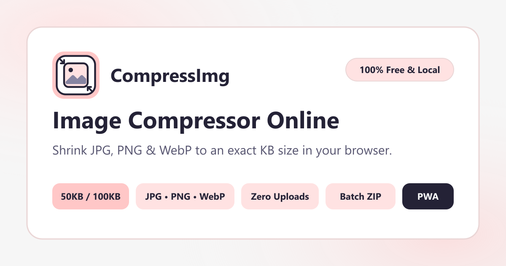

<div align="center">


# CompressImg — Private Browser Image Compressor

**Shrink JPG, PNG, WebP, GIF & SVG images to an exact KB size — 100% locally in your browser.**

[](https://compress-img.github.io/)
[](https://astro.build/)
[](https://react.dev/)
[](https://www.typescriptlang.org/)
[](#offline-pwa-support)
[](LICENSE)

<br />



</div>

---

## Overview

**CompressImg** ([https://compress-img.github.io/](https://compress-img.github.io/)) is a fast, distraction-free, zero-upload image compression web app built with **Astro 5 Islands Architecture** and **React 19**. Unlike traditional compressors that upload personal photos or documents to remote servers, CompressImg runs every pixel operation inside your own browser using Web Workers, HTML5 Canvas / `OffscreenCanvas`, and client-side encoders.

- **Zero Server Uploads:** Files never leave your device.
- **Exact KB Targets:** One-click `20KB`, `50KB`, `100KB`, `200KB`, or any custom KB limit.
- **Zero Watermarks & No Limits:** Compress single images or entire batches for free.
- **Works Offline:** Installable Progressive Web App (**Add to Home Screen**).

---

## Key Features

| Feature | Description |
| :--- | :--- |
| **Exact Target Size (KB) Solver** | Binary-search quality solver (`0.08`–`0.96`) with proportional downscaling fallback when needed to hit strict `20KB`, `50KB`, `100KB`, `200KB`, or custom KB upload caps cleanly. |
| **Quality & Format Conversion** | Smooth `10%–100%` quality slider and one-click conversion between **Original**, **JPG**, **PNG**, and **WebP** (preserving alpha transparency on PNG & WebP). |
| **Anti-Bloat Size Protection** | Same-format compression automatically steps down cleanly or preserves exact original bytes if an already-optimized file cannot be shrunk further—never inflating file sizes. |
| **5 Image Formats Supported** | Compresses **JPG/JPEG**, **PNG** (lossy palette quantization & lossless via `upng-js`), **WebP**, **GIF** (frame-accurate animated/static quantization via `omggif` + `gifenc`), and **SVG** (pure-TS XML optimization). |
| **Interactive Before / After Inspector** | Pointer-draggable and keyboard-accessible (`ArrowLeft`/`ArrowRight`/`Home`/`End`) comparison split slider showing live Original KB vs. Compressed KB, dimensions, and exact `%` saved. |
| **Batch Processing & ZIP Export** | Drag-and-drop, paste (`Ctrl+V`), or select multiple images, monitor progress, download individually, or bundle everything into `compressimg-batch.zip` client-side via `JSZip`. |
| **Clean Light & Dark Themes** | Minimal `#FFC7C7` / `#FFE2E2` / `#F6F6F6` / `#8785A2` palette with `#14131D` dark mode, zero-FOUC theme persistence, and WCAG AA+ contrast (`≥ 4.5:1`). |

---

## How the Client-Side Engine Works

```text
  Dropped / Pasted Files
           │
           ├──► SVG (Original) ──────► Pure-TS XML & path precision optimizer
           │
           ├──► GIF (Original) ──────► omggif frame decoder ──► gifenc palette quantizer
           │
           └──► JPG / PNG / WebP ────► Inline Web Worker (OffscreenCanvas + upng-js)
                                               │
                         ┌─────────────────────┴─────────────────────┐
                         ▼                                           ▼
                   Quality Mode                               Target Size (KB)
             Encode at chosen % with                    Skip if original ≤ target;
             anti-bloat original check                  else binary search quality
                                                        + proportional scale fallback
```

---

## Multilingual Support (8 Languages)

Every route (**Home**, **How to Use**, and **Hire Me**) is statically generated across 8 locales with full `hreflang` + `x-default` tags and localized Open Graph & JSON-LD structured data:

| Language | Locale Code | URL Prefix |
| :--- | :--- | :--- |
| English | `en` | `/` |
| Español | `es` | `/es/` |
| Português | `pt` | `/pt/` |
| Deutsch | `de` | `/de/` |
| Français | `fr` | `/fr/` |
| 日本語 | `ja` | `/ja/` |
| 简体中文 | `zh` | `/zh/` |
| Русский | `ru` | `/ru/` |

---

## Architecture, SEO & Performance

- **Islands Architecture:** Static Astro HTML shell (`0 KB` framework JS on `/how-to-use/` and `/hire-me/`); React 19 hydrates strictly the interactive `ImageCompressorIsland` (`client:load`) on Home.
- **Technical SEO & Structured Data:**
  - Strict title lengths (`50–60` chars) and meta descriptions (`130–155` chars) with self-referencing canonicals.
  - Direct flat XML `<urlset>` sitemap generated at [`src/pages/sitemap.xml.ts`](src/pages/sitemap.xml.ts) (`/sitemap.xml`) with `xhtml:link` alternates across all 8 languages + `x-default`.
  - JSON-LD schemas: `WebApplication` (`$0` free utility, zero fake `aggregateRating`) and `FAQPage` on Home; `BreadcrumbList` + `HowTo` on `/how-to-use/`; `BreadcrumbList` + `Person` on `/hire-me/`.
- **Accessibility:** Semantic `<header>`, `<nav>`, `<main>`, `<section>`, and `<footer>` landmarks, keyboard-accessible dropzone (`role="button"`, `tabindex="0"`), `aria-pressed` toggles, `aria-valuenow`/`aria-valuetext` sliders, `aria-live="polite"` compression status updates, and `48×48px` icon-only mobile/tablet navigation controls.

---

## Offline PWA Support

CompressImg includes [`public/manifest.webmanifest`](public/manifest.webmanifest) and a cache-first/stale-while-revalidate Service Worker ([`public/sw.js`](public/sw.js)):

1. Click **Add to Home Screen** inside the header toggle menu.
2. On Chromium/Android/Desktop browsers, confirm the native install prompt. On iOS Safari, follow the built-in step-by-step popover (**Share → Add to Home Screen**).
3. Once cached, compression and batch ZIP exports operate **100% offline**.

---

## Project Structure

```text
├── .github/
│   ├── FUNDING.yml
│   └── workflows/
│       └── deploy.yml                # Automated GitHub Pages build & deploy
├── public/
│   ├── icons/                        # PWA & Apple Touch PNG icons
│   ├── favicon.svg
│   ├── manifest.webmanifest
│   ├── og-image.png                  # Static 1200x630 Open Graph preview
│   ├── robots.txt
│   └── sw.js                         # Offline-first Service Worker
├── src/
│   ├── components/
│   │   ├── BeforeAfterSlider.tsx     # Interactive comparison & metrics bar
│   │   ├── Breadcrumbs.astro         # Subpage breadcrumb trail
│   │   ├── Footer.astro
│   │   ├── ImageCompressorIsland.tsx # React 19 client:load workspace
│   │   └── Navbar.astro              # Minimal header + toggle menu
│   ├── i18n/
│   │   ├── locales.ts                # Locale config, static paths, canonical helpers
│   │   └── translations.ts           # Full translations across 8 languages
│   ├── layouts/
│   │   └── BaseLayout.astro          # Theme anti-FOUC, SEO meta, JSON-LD, GTM/GA4, PWA init
│   ├── lib/
│   │   ├── compression-engine.ts     # Quality & Exact-KB solvers + anti-bloat logic
│   │   ├── compression-types.ts
│   │   ├── compressor-client.ts      # Inline Web Worker manager + sample generator
│   │   └── svg-optimizer.ts          # Pure TypeScript SVG minifier
│   ├── pages/
│   │   ├── [...lang]/
│   │   │   ├── hire-me.astro
│   │   │   ├── how-to-use.astro
│   │   │   └── index.astro
│   │   └── sitemap.xml.ts            # Flat <urlset> XML endpoint
│   ├── styles/
│   │   └── global.css                # Light/Dark tokens & GPU-accelerated animations
│   ├── types/
│   │   └── codecs.d.ts               # Declarations for upng-js, omggif & gifenc
│   ├── workers/
│   │   └── compress.worker.ts        # Off-main-thread compression worker
│   └── env.d.ts
├── astro.config.mjs
├── package.json
├── tailwind.config.mjs
└── tsconfig.json
```

---

## Local Development

### Prerequisites

- **Node.js** `>= 20.x`
- **npm** `>= 10.x`

### Commands

```bash
# 1. Clone the repository
git clone https://github.com/compress-img/compress-img.github.io.git
cd compress-img.github.io

# 2. Install dependencies
npm install

# 3. Start the local dev server (http://localhost:4321)
npm run dev

# 4. Run Astro & TypeScript diagnostics
npm run check

# 5. Build the static production site into ./dist
npm run build

# 6. Preview the production build locally
npm run preview
```

---

## Deployment

Every push to `main` triggers [`.github/workflows/deploy.yml`](.github/workflows/deploy.yml), which configures GitHub Pages (`actions/configure-pages@v5`), builds the static Astro output via `withastro/action@v3`, and publishes to `https://compress-img.github.io/` via `actions/deploy-pages@v4`.

---

## Author & Support

Created and maintained by **Kishara Dilshan**.

- **Support Development:** [Buy me a coffee on Gumroad](https://kisharadilshan.gumroad.com/coffee)
- **Freelance & Custom IT Solutions:** Need an ultra-fast Astro, React, or Next.js web app or client-side WebAssembly tool? Visit the [Hire Me page](https://compress-img.github.io/hire-me/) or email [`kisharadilshan007@gmail.com`](mailto:kisharadilshan007@gmail.com).

---

## License

Licensed under the [MIT License](LICENSE) — Copyright © 2026 **Kishara Dilshan**.
